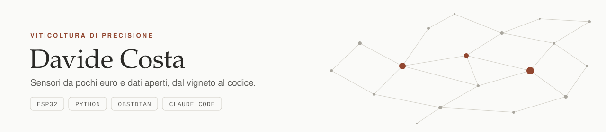

<picture>
  <source media="(prefers-color-scheme: dark)" srcset="banner-scuro.svg">
  
</picture>

# Ciao, sono Davide

Studio Scienze e Tecnologie Agrarie (LM-69) all'Università di Padova, dopo la triennale in Viticoltura ed Enologia a San Michele all'Adige. Vengo dal vigneto, non dall'informatica: il codice che trovi qui nasce da problemi che ho incontrato in campo.

Mi interessa la viticoltura di precisione fatta con poco: sensori da pochi euro e dati aperti, con strumenti che funzionano in vigna anche quando la rete non c'è.

## Progetti

**[VigneInsight](https://github.com/Davidino89-byte/vigneinsight)**
Una stazione agrometeorologica con un ESP32 e un sistema di supporto alle decisioni per il vigneto. Misura il microclima tra i filari, calcola gradi-giorno, rischio di peronospora e oidio e copertura dei trattamenti, e mette tutto accanto alle previsioni, all'NDVI di Sentinel-2 e al bollettino fitosanitario regionale. Il nodo costa circa 50 €, la pipeline è in Python senza librerie esterne. Lo sto costruendo in pubblico. La [demo online](https://davidino89-byte.github.io/vigneinsight/) gira su una stagione di dati di esempio.

**[App per i rilievi in vigneto](https://github.com/Davidino89-byte/app-rilievi-vigneto)**
Una web app da installare sul telefono per i rilievi di campo (mal dell'esca, germogli, grappoli, scottature), con la posizione GPS di ogni punto. Funziona senza rete e sincronizza su Google Sheets. L'ho scritta in cinque giorni durante il tirocinio.

## Il mio second brain

Da maggio 2026 tengo tutto in un vault Obsidian che gestisco con Claude Code: università, progetti, finanze personali, allenamenti, letture. Le note sono la parte che si vede; intorno ci sono agenti, script e regole che le tengono in ordine.

- 14 agenti, ognuno con un compito e dei confini scritti nel suo prompt. Per esempio, quello che valuta un ETF non può leggere la mia strategia di investimento, così la valutazione dello strumento non si piega a quello che ho già deciso.
- Le lezioni entrano come trascrizione, PDF o slide ed escono come appunti da ricopiare a mano, domande d'esame e flashcard con ripetizione spaziata (SM-2). In questo semestre ne ho processate 29.
- Un hook controlla ogni comando prima che parta e blocca l'invio di email, le cancellazioni e i comandi distruttivi. Ha 148 test, tutti verdi. Una regola scritta in un file sotto pressione si può dimenticare, un hook no.
- Ogni fatto ha una sola pagina di riferimento, e uno script trova le pagine che riportano ancora la versione superata.
- Niente processi in background: il sistema si muove solo quando lo lancio io.
- Fuori dal vault: i widget per iPhone, un comando rapido per salvare al volo dal telefono e quattro mod per l'interfaccia di Claude Code.

In numeri: circa 1.070 note, di cui 233 di wiki, 28 script Python, 21 comandi, 431 commit. Il repository è privato perché dentro c'è la mia vita; qui sopra c'è come funziona.

## Da dove arrivo

- 1.050 ore di tirocinio in vigneto: rilievi sulle strutture legnose della vite, mal dell'esca, fallanze.
- Una tesi triennale sui lieviti non-Saccharomyces: quanto resistono ai fattori limitanti del mosto e come si comportano in fermentazione accanto a *Saccharomyces cerevisiae*.

## Con cosa lavoro

Python, JavaScript e React, ESP32 con Arduino e PlatformIO, Obsidian e Claude Code.
